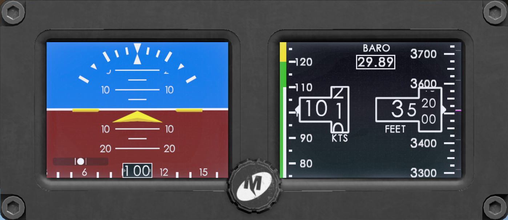
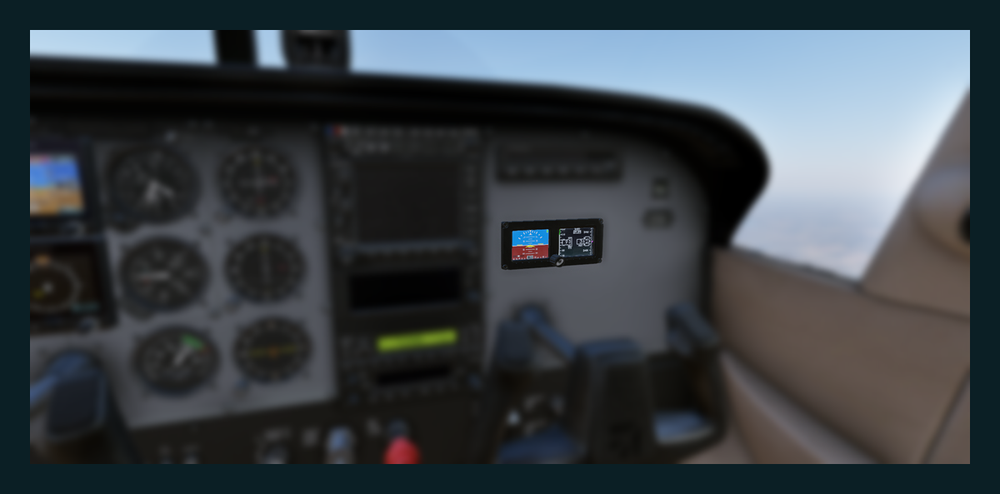
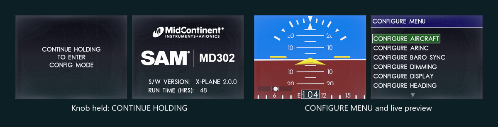
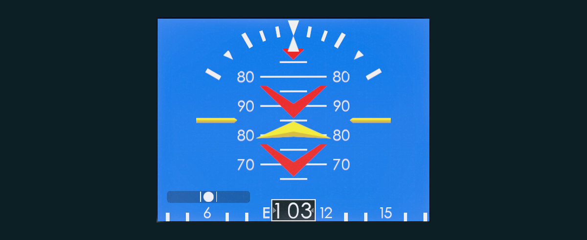
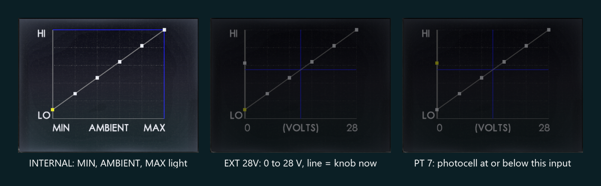
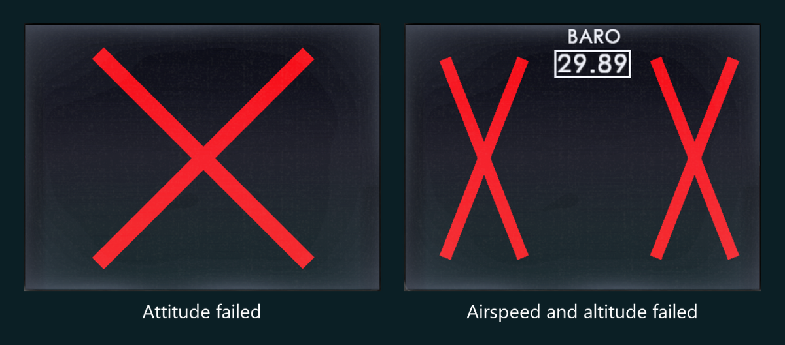
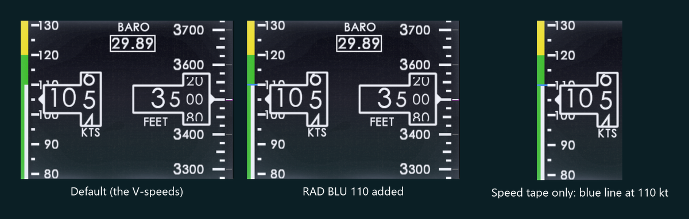

# MD302 for X-Plane 12

The Mid-Continent MD302 Standby Attitude Module, rebuilt for X-Plane 12.

Two tiny screens, one knob, and a battery that keeps going when the rest of the panel goes dark.



## A quick look

<table>
<tr>
<td width="50%"><br>
<sub>Kill the aircraft power. The MD302 carries on, on its own battery.</sub></td>
<td width="50%"><br>
<sub>Yes, the installer's Configuration Mode is in there too. Live preview included.</sub></td>
</tr>
<tr>
<td><br>
<sub>Pull to 85°. The ladder keeps going over the top, red chevrons pointing home.</sub></td>
<td><br>
<sub>The real dimming curve: photocell, panel-light knob, the lot.</sub></td>
</tr>
<tr>
<td><br>
<sub>Fail it properly: a red X over whatever lost its sensor.</sub></td>
<td><br>
<sub>Speed bands from the aircraft's V-speeds, or painted by hand.</sub></td>
</tr>
</table>

## Read the manual

Everything lives in **[MD302_Manual.pdf](MD302_Manual.pdf)**: flying it, setting it up, every setting,
command and dataref, and where it differs from the real unit.

This README stays short on purpose. One place to update, one place to look.

## What you get

- Attitude, slip and heading on one screen; airspeed, baro and altitude tapes on the other
- The knob works in the 3D cockpit, in a pop-up you can drag to another monitor, or from keys,
  joystick and VR buttons
- An internal battery: lose aircraft power in flight and it keeps flying with you (for a while)
- The real unit's red X failures and message boxes, plus datarefs to break things on purpose
  (instructors, this one's for you)
- The installer's Configuration Mode, with a live preview of every change
- Horizontal or vertical: it works out which from how it sits in Plane Maker
- Screens that look like the real cheap 320 x 240 TFTs, backlight glow and all

## Quick start (aircraft authors)

1. Copy this folder to `<aircraft>/plugins/xlua/scripts/MD302/` (the name must be exactly `MD302`).
2. In Plane Maker, attach `../plugins/xlua/scripts/MD302/3D/MD302.obj` as a misc object
   (an ordinary object, **not** the cockpit object).
3. In `config.ini`, set `power_bus` to the electrical bus that feeds it.
4. Go fly.

Vertical panels, heading sources, air data, dimming and the rest: manual, *Installation and Settings*.

**Needs** X-Plane 12.4.4 with Panel Graphics, and xLua 2.0 in the aircraft's `plugins/xlua/`
(tested with 2.0.0-b5). Tested on Windows only; Mac and Linux are untested so far.

## Under the hood

- Drawn live with the XPLM 4 Panel Graphics API through xLua 2.0, onto an `ATTR_cockpit_device` screen.
- Each LCD is a 500 x 374 picture standing in for 320 x 240 pixels. The backlight band, the edge bleed and
  the pixel grain (`Textures/lcd_*.png`) come from photos of the real unit.
- The colours were taken from photos of the black-bezel unit, each calibrated on the screen's own white.
- X-Plane only clicks the cockpit object, so the 3D knob is clicked by a ray test of our own
  (`md302_pick.lua`).
- Where Mid-Continent's manual has no screen dump (the BATTERY STORAGE and CLEAR SSEC TABLE boxes, the
  RANGE MARKINGS page), the layout is ours.

Behaviour follows Mid-Continent's *Installation Manual and Operating Instructions*, 9017782 rev Q
(March 2024).

## Files

```
MD302.lua             master script: lifecycle, config.ini, datarefs, commands, device, flight loop
md302_unit.lua        behaviour: power, battery, knob, Options Menu, brightness, baro
md302_config.lua      Configuration Mode
md302_fail.lua        failure X, message boxes, battery check
md302_lcd.lua         the LCD look
md302_display.lua     the two LCDs
md302_gfx.lua         drawing layer and raster fonts
md302_util.lua        config.ini, dataref and command helpers
md302_pick.lua        3D knob clicks
md302_font_data.lua   fontbook metrics (generated)
md302_bezel.lua       the pop-up's bezel: LCD and knob positions (generated with Textures/popup_bezel.png)
config.ini            the unit's memory, documented line by line
MD302_Manual.pdf      the manual
3D/                   MD302.obj (unit, screen device laminar_md302, click regions) and its textures
Textures/             sprites cut from the 2024 art; the LCD look; anti-aliased lines; the pop-up's face; Font/
docs/                 gallery: the pictures above; perf: the pop-up opened and closed 300 times, measured in X-Plane
```

Version: 2026-11-03 (manual 9017782 rev Q; the S/W VERSION the unit shows is "X-PLANE 2.0.0").

## Credits

MD302 for X-Plane by Tiezheng Eric Xu for Laminar Research. The text is drawn from PNG glyph atlases
(`Textures/Font/`, no font files are shipped) cut from the 2024 MD302 art; characters that art did not contain
(Z J Q - _ : , + < > ° = % ? #) were drawn to match. The lettering is set about one LCD pixel a letter tighter than
that art, as the unit's. Behaviour per Mid-Continent's manual 9017782 rev Q (and rev B); the manuals are not
included.

Mid-Continent and MD302 are trademarks of Mid-Continent Instruments and Avionics. This project is not affiliated
with or endorsed by Mid-Continent.

## License

Copyright (c) 2026 Tiezheng Eric Xu, erix@x-plane.com, Laminar Research. MIT; see [LICENSE](LICENSE).
